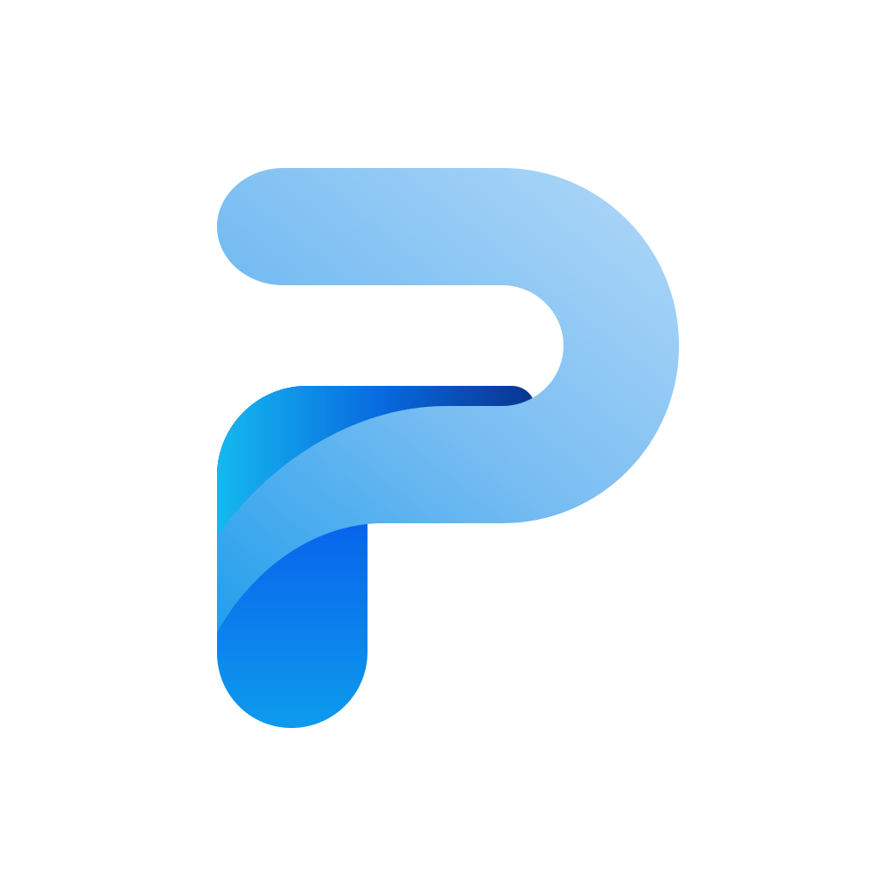
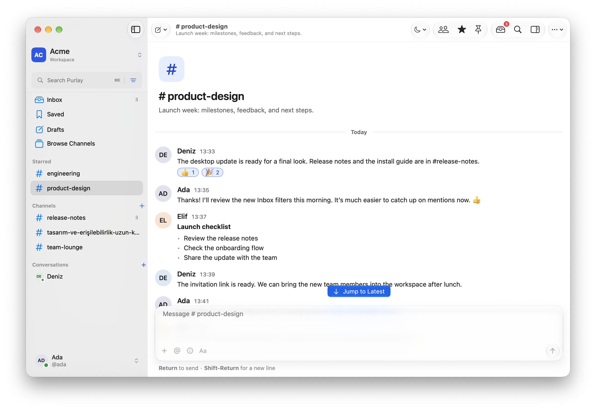

<div align="center">
  
  <h1>Purlay for Apple platforms</h1>
  <p>Your team’s conversations, native on iPhone, iPad and Mac.</p>
  <p>The SwiftUI clients of <a href="https://github.com/purlay/purlay">Purlay</a>, team chat today and the modules that follow it, drawn in Liquid Glass.</p>
  <p>
    
    
    
    
    <a href="https://github.com/purlay/purlay-apple/actions/workflows/ci.yml"></a>
    <a href="LICENSE"></a>
  </p>
</div>

<picture>
  <source media="(prefers-color-scheme: dark)" srcset="docs/images/workspace-dark.png">
  
</picture>
<p align="center"><sub>Purlay for Mac 0.3.0 · example workspace</sub></p>

## What it is

- **Native.** SwiftUI with the system's own navigation, toolbars, sheets, windows and materials, not a web page in a frame.
  Liquid Glass from iOS 26 and macOS 26; iOS 18–25 get a system material in the same shape.
- **No password in the app.** Sign-in goes through the system browser to the server's own page and returns with a one-time code
  bound to a secret the app keeps (PKCE). The session lives in the Keychain.
- **As modular as the server.** A module the workspace does not run is not shown, and one the app does not know is ignored.
- **Calm and safe.** Notices never show what was said; an idle app makes no request. The Mac app is sandboxed, signed, notarized,
  and updates itself with signed updates.

| | Status |
|---|---|
| **Mac** (macOS 26 or later, Apple silicon) | Released ([latest version](Apps/macOS/CHANGELOG.md)). Signed and notarized builds that update themselves with Sparkle. [What’s new](Apps/macOS/CHANGELOG.md) |
| **iPhone and iPad** (iOS 18 or later) | In development; not yet distributed. [What’s new](Apps/iOS/CHANGELOG.md) |

## Build

You need an Apple silicon Mac with Xcode 27.2 or later, and `gh` signed in.

```sh
make setup        # the pinned contract bundle, the secret scanner, the git hooks
make verify       # what a pull request must pass: the rules, format and every package test, both apps built
open Apps/Purlay.xcodeproj
```

The schemes are `Purlay-iOS` and `Purlay-macOS`. A Debug build can talk to another server with `PURLAY_DEV_SERVER`;
[getting started](docs/development/getting-started.md) has the rest.

## How it is built

```
Package.swift      one package: the contract and tokens (generated from the server's bundle), the engine, the design system,
                   the module API and the Mac's screens
Apps/              Purlay.xcodeproj (the app targets only), iOS/ and macOS/: each app's composition root and its changelog
Config/            every build setting    TestPlans/   the test plans    Contract/   the pinned server contract
Tools/PurlayGen/   the generator          scripts/     the checks, the build tools, CI's helpers
docs/              the documentation
```

## Documentation

| Folder | Holds |
|---|---|
| [`docs/`](docs/README.md) | the entry point: where things stand, the rules, and the map |
| [`docs/product/`](docs/product) | the vision, and the requirements of both apps and the engine |
| [`docs/design/`](docs/design) | screen and flow designs |
| [`docs/architecture/`](docs/architecture) | how it fits together, the modules and their layers, the conventions, the technical debt |
| [`docs/decisions/`](docs/decisions/README.md) | the architecture decisions: what was chosen, and what was rejected |
| [`docs/development/`](docs/development) | getting started, testing, CI, the contract, releasing, what can go wrong |
| [`docs/runbooks/`](docs/runbooks/README.md) | step-by-step procedures |

## Part of Purlay

The server and the source of truth of the contract is [`purlay`](https://github.com/purlay/purlay); its README maps all the
repositories.

## History

These apps were developed in three repositories before this one: [`purlay-ios`](https://github.com/purlay/purlay-ios),
[`purlay-macos`](https://github.com/purlay/purlay-macos) and [`purlay-swift`](https://github.com/purlay/purlay-swift). They are
archived, read-only; what they held is here. The details are in [`docs/README.md`](docs/README.md).

## License

[AGPL-3.0](LICENSE). Contributing: [`CONTRIBUTING.md`](CONTRIBUTING.md); contributions are under the
[contributor licence agreement](CLA.md). Security reports: [`SECURITY.md`](SECURITY.md). Third-party notices: [`NOTICE`](NOTICE).
